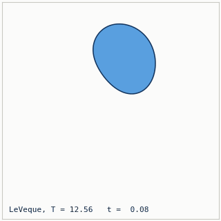
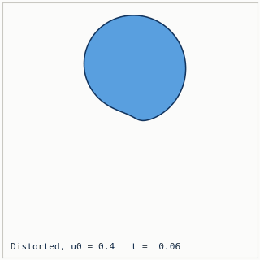
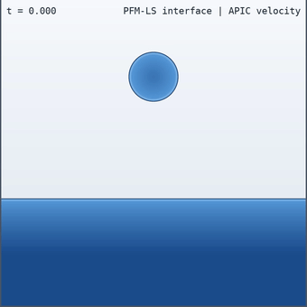
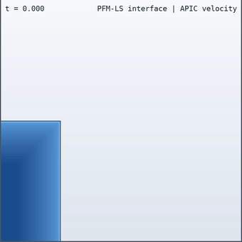
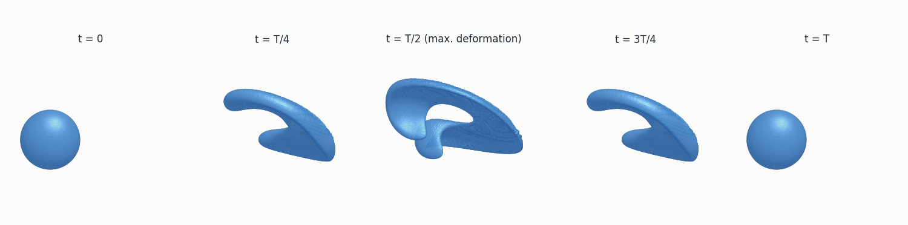
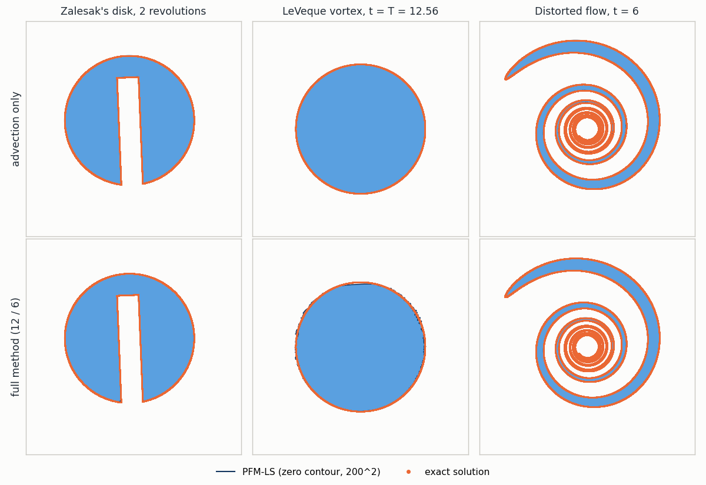

# PFM-LS: A Level Set Method on Particle Flow Maps

A GPU implementation in [NVIDIA Warp](https://github.com/NVIDIA/warp) of the level-set method of

> J. He, T. Zhang, Z. Li, J. Zhou, D. Chen, B. Zhu. *A Level Set Method on Particle Flow Maps.*
> International Journal for Numerical Methods in Engineering 127(20), e70441, 2026.
> [doi:10.1002/nme.70441](https://doi.org/10.1002/nme.70441) | [arXiv:2601.09939](https://arxiv.org/abs/2601.09939)

with the paper's 2D interface-tracking benchmarks (Zalesak's disk, LeVeque's vortex, the Distorted flow), its 3D
LeVeque sphere, its 2D droplet-splash free-surface example and a 2D dam break.

<table>
<tr>
<td width="50%"><br><sub><b>LeVeque's vortex</b> (advection only with adaptive seeding, 200^2): stretched into a thin spiral and back to the circle at t = T = 12.56</sub></td>
<td width="50%"><br><sub><b>Distorted flow</b> (full method, 200^2): a circle wound into a thin spiral</sub></td>
</tr>
<tr>
<td width="50%"><br><sub><b>Droplet splash</b> (200^2): the paper's free-surface setup with the PFM-LS interface</sub></td>
<td width="50%"><br><sub><b>Dam break</b> (400^2): run-up to the lid, plunging breaker and sloshing, with the PFM-LS interface</sub></td>
</tr>
</table>


<sub><b>3D deformed sphere</b> (Enright's field, research protocol, 50^3): the sphere is stretched into a thin sheet
at t = T/2 and returns to 100.0000% of its volume at t = T.</sub>

All media are rendered from the outputs of the examples below.

## Repository layout

```
pfmls/core/        kernels (B-splines, Hermite), grids, cell lists, eikonal redistancing, measurement (2D and 3D)
pfmls/levelset/    PFMLevelSet2D / PFMLevelSet3D, quasi-Newton redistancing, initial shapes (sdf, sdf3d)
pfmls/flows/       analytic benchmark flows (2D and 3D) and MAC-grid velocities
pfmls/fluid/       2D free-surface solver: PFM-LS interface, ghost-fluid pressure, APIC transport, scenes, runner
pfmls/render/      2D water renderer and the MP4 / GIF / PNG writer
examples/          benchmarks/ (zalesak, leveque, distorted, sphere3d), water/ (droplet_splash, dam_break)
docs/method.md     method summary, parameter guide, 3D specifics and limitations
tests/             pytest suite (CPU and GPU)
assets/            README media
```

## The method in brief

PFM-LS moves the interface with particles in a narrow band around it. Every particle carries a level-set value, its
gradient and a normal-gradient matrix along two flow maps of different length: the long map (restarted every 12
steps by default) transports the value and the gradient, the short map (every 6 steps) the normal-gradient matrix.
A grid cell whose centre has a particle within a quarter cell takes the particles' Taylor reconstruction; elsewhere a
background grid level set (semi-Lagrangian advection and eikonal redistancing) supplies the field. At every long
reinitialisation the band is redistanced by a quasi-Newton closest-point projection onto the particle-interpolated
surface and reseeded. In between, adaptive seeding can add particles to band cells that the flow has thinned out
(the advection-only protocol tops up cells holding fewer than ppc / 2). [docs/method.md](docs/method.md) gives the
details, the parameter guide and the 3D specifics.

- **Level sets** `pfmls.PFMLevelSet2D` and `pfmls.PFMLevelSet3D`. Each step is captured into CUDA graphs (no host
  synchronisation inside a 2D step), the 3D solver stores particles only for the narrow band, and both also run on
  Warp's CPU device.
- **Benchmarks** with the paper's protocols: Zalesak's disk, LeVeque's vortex and the Distorted flow in 2D, the
  deformed sphere in 3D; areas and volumes by marching squares / cubes, shape errors as chamfer and Hausdorff
  distances to the exact solution.
- **2D water examples** (`pfmls.fluid`): the paper's droplet splash and a dam break, incompressible free-surface
  flows on a MAC grid with ghost-fluid pressure and surface tension, the PFM-LS interface and APIC velocity
  transport.

## Install

```bash
git clone https://github.com/jinjinhe2001/Particle-Flowmap-Levelset.git
cd Particle-Flowmap-Levelset
pip install -e .              # warp-lang, numpy, scipy, scikit-image, matplotlib, pillow, imageio, imageio-ffmpeg
pip install -e ".[test]"      # adds pytest
```

- **Python and Warp.** Python >= 3.10 and `warp-lang >= 1.8`. The example scripts also run from a source checkout
  without `pip install -e .`, as long as the dependencies are installed.
- **GPU and driver.** An NVIDIA GPU is recommended. Recent `warp-lang` wheels from PyPI are built with CUDA 13 and
  need a driver that supports CUDA 13 (R580 or newer). With an older driver Warp finds no CUDA device and
  everything runs on the CPU (the water examples print a warning, the benchmarks print `device=cpu`); install a
  CUDA 12 build of Warp instead (see Warp's installation guide). `python -c "import warp; warp.init()"` lists the
  driver version and the devices Warp found.
- **First run.** Warp compiles the kernels the first time they are used: about 25 s for the 2D level set, 40 s for
  the 3D level set and 30 s for the 2D water solver on an RTX 4090. The kernels are cached (`~/.cache/warp` on
  Linux, `%LOCALAPPDATA%\NVIDIA\warp\Cache` on Windows; `WARP_CACHE_PATH` overrides it), and later runs start in
  about a second.
- **CPU.** Everything also runs on Warp's CPU device, slowly: for example `PFMLevelSet2D(res=64, device="cpu")`, or
  `python examples/water/droplet_splash.py --device cpu --res 64 --t-end 0.5 --no-render`.

## Quick start

### 2D level set

```python
import pfmls

ls = pfmls.PFMLevelSet2D(res=200, ppc=16, band=2.0, reinit_long=12, reinit_short=6)
ls.init_from_sdf(pfmls.sdf.circle((0.5, 0.75), 0.15))      # phi < 0 inside
flow = pfmls.flows.LeVequeVortex2D(period=12.56)
for _ in range(628):
    ls.step(0.02, flow)
print(ls.area())                 # about 0.07044 (99.65% of pi 0.15^2): marching squares on a 5x reconstruction
phi = ls.phi_grid()              # (200, 200) numpy array of the grid level set
```

The loop takes 1-2 s on a GPU (after the first-run compilation). The analytic flows are `Rotation2D`,
`LeVequeVortex2D` and `Distorted2D`.

**Your own velocity.** A velocity stored on a MAC grid is wrapped by `MACVelocity2D(ux, uy, dx)`:

- the domain is `[0, nx dx] x [0, ny dx]` (`dx = 1 / nx` unless the level set is built with `dx=`), and the level
  set is cell-centred;
- `ux` has shape `(nx + 1, ny)` (x-faces at `(i dx, (j + 1/2) dx)`) and `uy` has shape `(nx, ny + 1)`;
- both are float32 Warp arrays (`wp.array(u, dtype=float, device=ls.device)`) on the level set's device. Other
  inputs raise `TypeError`; `step` raises `ValueError` for arrays on another device, for a grid mismatch and for a
  non-finite `dt`.

The solver reads the arrays by reference, so a fluid solver can update them in place (CUDA graphs are cached
per array address, so do not reallocate them every step). The intervals `reinit_long` and `reinit_short` are
counted in steps by default. Keep the number of long reinitialisations per unit time roughly constant when you
change `dt`: `reinit_unit="time"` gives the intervals in time units. The advanced options are listed in
`pfmls.PFMLS2DOptions`; [docs/method.md](docs/method.md) explains them and the validated range.

### 3D level set

The 3D solver has the same interface (`MACVelocity3D` for MAC velocities):

```python
import pfmls

ls = pfmls.PFMLevelSet3D(res=100, ppc=64, reinit_long=0, reinit_short=5, seed_min=16)  # research protocol
ls.init_from_sdf(pfmls.sdf3d.sphere((0.35, 0.35, 0.35), 0.15))
flow = pfmls.flows.Enright3D(period=10.0)
for _ in range(500):
    ls.step(0.02, flow)
print(ls.volume())               # about 0.014135 (99.98% of the exact sphere): marching cubes, 4x reconstruction
verts, faces = ls.mesh()         # triangle mesh of the zero level set
```

See [docs/method.md](docs/method.md), section 4, for the 3D protocols and options.

### Benchmarks

```bash
python examples/benchmarks/zalesak.py   --protocol advection    # advection only
python examples/benchmarks/leveque.py   --protocol advection
python examples/benchmarks/distorted.py --protocol advection
python examples/benchmarks/zalesak.py                           # full method (reinitialisation every 12 / 6 steps)
python examples/benchmarks/leveque.py
python examples/benchmarks/distorted.py
python examples/benchmarks/sphere3d.py                          # 3D sphere, full method, 50^3
python examples/benchmarks/sphere3d.py --protocol research      # 3D sphere, research protocol
```

Each 2D run takes a few seconds and writes `volume.csv`, `summary.json`, `interface.png` (the final zero contour
against the exact solution) and the fine level-set field to `outputs/<name>_<protocol>_<res>` (`--out` overrides
it). `sphere3d.py` writes `volume.csv`, `summary.json` and PLY meshes at t = 0, T/4, T/2, 3T/4 and T. `--help`
lists the flags.

### Water

```python
import pfmls

solver = pfmls.fluid.get_scene("droplet_splash").make_solver()   # 200^2, PFM-LS interface, APIC velocity
solver.advance_to(1.0)
phi = solver.fine_phi(4)          # (800, 800) level set, negative in the liquid
print(solver.stats())             # NaN repairs, rejected reinitialisations, film closure, ...
```

Keyword arguments of `make_solver` override fields of `FluidConfig`; the PFM-LS options are
`FluidConfig(pfm_levelset=PFMBackendConfig(...))`. The command-line examples are listed under
[Water examples](#water-examples).

## Level-set benchmarks

2D, 200^2, 16 particles per cell, dt = 0.02. Shape errors are chamfer / Hausdorff distances to the exact solution
in units of dx (LeVeque: to the initial circle at t = T); the results do not depend on the GPU. Zalesak runs with a
3 dx band and B-spline reconstruction weights (the script's defaults). Adaptive seeding is on by default: band cells
holding fewer than 8 particles get new ones (`--seed-min 0` turns this off).

| benchmark | area | shape (chamfer / Hausdorff) |
|---|---|---|
| Zalesak, advection only, 630 steps (2 revolutions) | \|1 - A/A(0)\| = 3.5e-6 | 0.025 / 0.134 |
| LeVeque, advection only, t = T (628 steps) | A/A(0) = 1.0000002 (0.9953 at step 310) | 0.025 / 0.138 |
| Distorted, advection only, t = 6 | A/A(0) = 0.99777 | 0.095 / 1.414 |
| Zalesak, full method, 630 steps (2 revolutions) | 99.92% | 0.032 / 0.59 |
| LeVeque, full method, t = T (628 steps) | 99.65% (99.91% at step 310, near maximum deformation) | 0.214 / 1.07 |
| Distorted, full method, t = 6 | 99.60% | 0.082 / 3.73 |



3D deformed sphere: Enright's field with T = 10, 64 particles per cell, dt = 0.02; volumes against t = 0, shape
errors at t = T in dx. The full method reinitialises every 12 / 6 steps; the research protocol keeps one long flow
map for the whole run, reinitialises the short map every 5 steps and seeds particles adaptively.

| benchmark | volume at T/2 | volume at T | shape at T (chamfer / Hausdorff) | command |
|---|---|---|---|---|
| research protocol, 50^3 | 100.97% | 100.0000% | 0.0020 / 0.0082 | `sphere3d.py --protocol research` |
| research protocol, 100^3 | 100.32% | 100.0000% | 0.0017 / 0.0066 | `sphere3d.py --protocol research --res 100` |
| full method, 50^3 | 100.44% | 100.87% | 0.071 / 2.16 | `sphere3d.py` |
| full method, 100^3 | 99.97% | 100.007% | 0.028 / 2.11 | `sphere3d.py --res 100` |

At T/2 the sphere is a sheet thinner than a cell at 50^3, so the T/2 volume mostly measures how well the particles
and the 4x measurement grid cover it, and it can exceed 100%. At 50^3 the full method's long reinitialisation
cannot keep that sheet and leaves a flap (Hausdorff 2.2 dx at T); at 100^3 the volume returns to 100.007%.

## Water examples

| scene | command | default | RTX 4090 |
|---|---|---|---|
| droplet splash (the paper's setup): a drop falls into a pool, crown, central jet | `python examples/water/droplet_splash.py` | 200^2, t = 3.75 | 10 s (13 s with the MP4) |
| dam break: a column a x 2a collapses, run-up to the lid, plunging breaker | `python examples/water/dam_break.py` | 400^2, t = 6 | about 1 min |

Each run writes an MP4, `volume.csv`, `frames.csv` and `summary.json` to `outputs/water2d/<scene>` and ends with a
status (`completed`, `degraded` or `failed`; also the exit code). Repeated default runs of each scene ended
`completed` (which requires a volume drift below 1%), with a maximum volume drift of 0.25-0.29% (droplet splash) and
0.29-0.56% (dam break); the drift varies slightly from run to run.
[examples/water/README.md](examples/water/README.md) lists the options and limits.

## Speed

Level-set cost per step with CUDA graphs on an idle RTX 4090, measured with a separate timing harness (not
included); the 3D ranges span the undeformed and the most deformed sphere:

| level-set step | ms per step |
|---|---|
| 2D LeVeque vortex, 200^2, 16 ppc, advection only with adaptive seeding (without) | 0.13 (0.06) |
| 2D LeVeque vortex, 200^2, 16 ppc, full method (seeding off) | 0.22 |
| 3D deformed sphere, 128^3, 64 ppc, research protocol | 1.8-2.9 |
| 3D deformed sphere, 128^3, 64 ppc, full method | 3.4-7.3 |

The benchmark scripts print a higher cost per step, because it includes a device synchronisation at every
measurement. For comparison, the paper reports 36 ms per step for the full method on a single consumer GPU.

## Tests

```bash
pytest                    # CPU always, CUDA tests too when a GPU is available
pytest --cpu-only         # CPU only (or set PFMLS_TEST_DEVICE=cpu); pytest -m "not gpu" deselects the GPU tests
```

The suite (132 tests) takes 1-2 min on an RTX 4090 and a CPU-only run (92 tests) about 1 min, once the kernels
are compiled; the first run also compiles them and takes a few minutes longer.

## Citation

If you use this code, please cite the paper:

```bibtex
@article{he2026pfmls,
  title   = {A Level Set Method on Particle Flow Maps},
  author  = {He, Jinjin and Zhang, Taiyuan and Li, Zhiqi and Zhou, Junwei and Chen, Duowen and Zhu, Bo},
  journal = {International Journal for Numerical Methods in Engineering},
  volume  = {127},
  number  = {20},
  pages   = {e70441},
  year    = {2026},
  doi     = {10.1002/nme.70441}
}
```

[CITATION.cff](CITATION.cff) holds the same reference (GitHub shows it as "Cite this repository").

## License

MIT, see [LICENSE](LICENSE).
